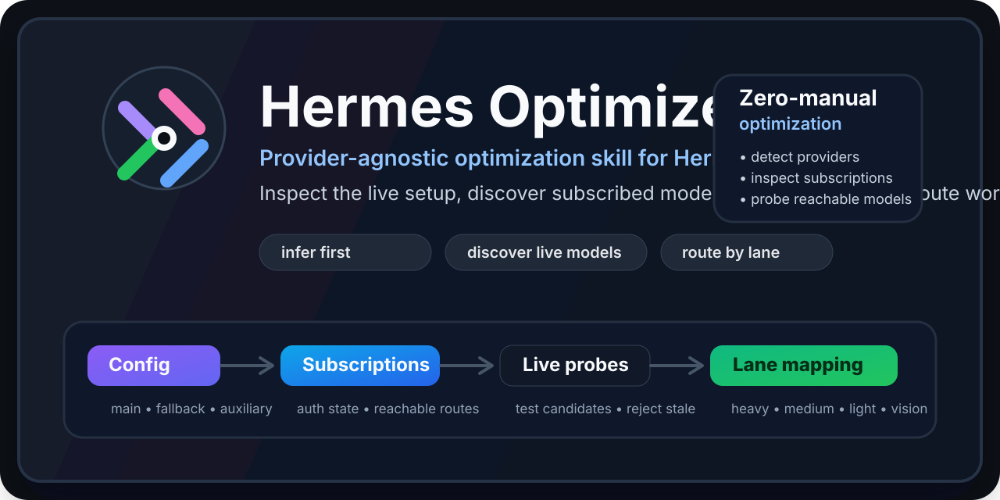
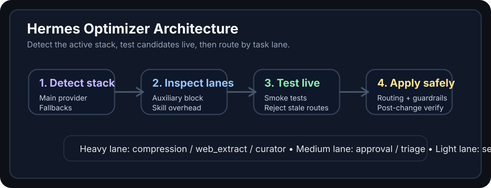

<div align="center">


# ⚙️ Hermes Optimizer


**A Hermes skill that walks you through bring-up and tuning in guided phases: providers, auxiliary routing, plugins, document tooling, skills, and guardrails. It asks by phase, acts in the Desktop app, and verifies live.**

<a href="#-quick-start">Quick Start</a> - <a href="#-the-guided-loop">The Guided Loop</a> - <a href="#-honest-starting-point">Starting Point</a> - <a href="#-features">Features</a> - <a href="#-skill-package">Skill Package</a> - <a href="#-workflow">Workflow</a> - <a href="#-roadmap">Roadmap</a>



</div>

> Hermes Optimizer does **not** assume your provider, your subscription, or your model catalog. It inspects the active Hermes setup, asks what inspection cannot answer, and works in the Desktop app - not in your terminal.

> [!NOTE]
> Public examples in this repository are intentionally generic. The skill adapts to each user's real provider stack instead of pushing one person's model choices as a default.

---

## 💡 Concept

Most "optimizer" skills are somebody else's preset with new branding.

**Hermes Optimizer** is built around a stricter rule: **ask first, infer second, optimize third**.

It teaches Hermes to:

1. read the active configuration before asking anything,
2. ask only what inspection cannot answer - intent, budget posture, what you actually do,
3. work through **seven phases**, each ending in a checkpoint you approve,
4. drive the **Desktop app** surfaces that own each setting,
5. verify candidate models with real calls instead of trusting a picker entry,
6. split work into **heavy / medium / light / vision** lanes,
7. **reject heavy installs that duplicate a capability you already have**,
8. trim skills and verify the result before declaring success.

That makes it useful for:
- a fresh install that feels bare and you suspect should do more
- an install that is expensive because background work runs on the premium model
- mixed-provider setups with a broken or fake fallback chain
- people who have never installed a plugin and do not know what is missing
- anyone who says **"optimize my Hermes"** and expects a guided plan, not a preset

---

## 🪜 The Guided Loop

Every phase has the same shape:

```text
PHASE N - <name>
  Questions  -> ask, with concrete options
  Actions    -> do the work in the Desktop app
  Checkpoint -> show what changed, get a yes
```

The seven phases:

| Phase | Name | Goal |
|-------|------|------|
| 0 | Baseline audit | Read live state, report honestly what is thin |
| 1 | Provider and main model | Set provider, default model, reasoning, context |
| 2 | Auxiliary and fallback routing | Split lanes off the main model, add a real fallback |
| 3 | Plugins | Install the baseline set matched to your work |
| 4 | Local utilities and document tooling | Make PDFs and Markdown readable |
| 5 | Skills | Disable noise, keep the real domains |
| 6 | Guardrails, checkpoints, safety | Hard stop, checkpoints, smart approvals, audits |
| 7 | Verification and handoff | Re-read, smoke-test, before/after summary |

**Bring-up** runs all seven on a fresh or messy install. **Tune** runs only the phases that audit dirty on a working install.

Full per-phase question sets and checkpoint criteria: [`references/phase-plan.md`](skills/hermes-optimizer/references/phase-plan.md).

---

## 🔍 Honest Starting Point

A stock Hermes install is **thin by default**. Not broken - minimal. The skill says so out loud rather than implying the install was already fine:

- one main model, no fallback chain
- most auxiliary task slots pinned to the main model, so background work costs main-model money
- no third-party plugins, so no plugin toolsets exist yet
- a large bundled skill set where most entries are irrelevant to any one user
- loop hard stop off, so a stuck agent can spend without a ceiling
- no local document or data tooling

You should know what a phase buys before agreeing to it. Phase 0 exists to tell you exactly this, ranked by return.

---

## 🧭 Silly vs Smart

Every proposed install runs through an anti-bloat test. It is the part of this skill that saves the most money.

**Rejected by default:**

- a multi-gigabyte local OCR model **when your provider already has a working vision route** - that is a second, worse copy of a live capability you now maintain yourself
- a local embedding or reranker model when your context engine already serves semantic recall
- any local model that duplicates a hosted route you already pay for
- bundled skills for platforms your host does not run (Apple/macOS-only skills on Windows)
- narrow single-purpose integrations you never asked for

**Recommended by default:**

- a document and data loader for PDF and Markdown - structured text extraction is the base layer everything else sits on, and hosted vision does **not** replace it
- guardrails, checkpoints, and a real fallback chain - config, not downloads
- auxiliary routing that moves non-critical work off the premium main model
- plugins that fill a capability gap you genuinely have

When the skill rejects something, it says why: *"You already have vision on your main provider, so a local OCR model would be a downgrade you maintain yourself."*

---

## ✨ Features

| Feature | Description |
|---------|-------------|
| **Guided phases** | Seven phases, each with its own questions, actions, and an approval checkpoint. |
| **Desktop-first** | Drives the Desktop app surfaces that own each setting. CLI only for reading state and for what the app has no field for. |
| **Ask-first intake** | Asks what inspection cannot answer instead of applying a preset. |
| **Provider autodiscovery** | Reads the live setup before recommending anything. |
| **Lane-based routing** | Separates heavy, medium, light, and vision tasks by cost and capability. |
| **Plugin baseline** | Ships a matched plugin set for agent runtime, office files, and document reading, with a fit test. |
| **Anti-bloat test** | Rejects heavy local installs that duplicate a live hosted route. |
| **Document tooling** | Establishes PDF and Markdown text extraction as the base layer, using what is already installed first. |
| **Live verification** | Rejects stale catalog entries, retired models, and broken routes before recommending them. |
| **Guardrail upgrades** | Pushes hard stops, checkpoints, and safer approval modes. |
| **Honest accounting** | Disables skills rather than deleting them, and states the enabled-versus-installed difference. |
| **Desktop-compatible aux config** | Writes auxiliary routing in the exact per-task shape the Desktop Models page understands. |
| **GitHub-ready packaging** | Ships as a public repo, raw `SKILL.md`, and a reusable reference pack. |

---

## 🚀 Quick Start

Install directly from GitHub:

```bash
hermes skills install https://raw.githubusercontent.com/$OWNER/$REPO/main/skills/hermes-optimizer/SKILL.md -y
```

Load it in Hermes:

```text
/skill hermes-optimizer
```

Or simply ask:

```text
Help me bring my Hermes install up to speed.
```

The skill reads your live setup, reports the baseline, and then walks the phases with you. You approve each one.

<details>
<summary>⚙️ Advanced install and sharing modes</summary>

### Add the repository as a skill source

```bash
hermes skills tap add $OWNER/$REPO
```

### Share with a colleague

```bash
hermes skills install https://raw.githubusercontent.com/$OWNER/$REPO/main/skills/hermes-optimizer/SKILL.md -y
```

### Publication handoff

See [`PUBLISHING.md`](PUBLISHING.md) and [`RELEASE_COMMANDS.md`](RELEASE_COMMANDS.md).

</details>

---

## 🖥️ Where Each Phase Happens

The skill sends you to the app, not to a terminal.

| Phase | Desktop surface |
|-------|-----------------|
| Provider and main model | **Settings -> Models** (`/settings?tab=config:model`) |
| Auxiliary and fallback | **Settings -> Auxiliary rows / fallback models** |
| Plugins | **Capabilities -> Plugins** (`/capabilities?tab=plugins`) |
| Plugin settings | **Settings -> Plugins** |
| Skills | **Capabilities -> Skills** (`/capabilities?tab=skills`) |
| MCP / connectors | **Capabilities -> Connectors** (`/capabilities?tab=connectors`) |

The CLI stays available for reading state, verifying, and the few things the app has no field for - confirmed fallback chains, plugin validation, capability inspection, doctor, and the supply-chain audit. Full table: [`references/desktop-surfaces.md`](skills/hermes-optimizer/references/desktop-surfaces.md).

---

## 🧩 Skill Package

| File | Purpose |
|------|---------|
| `skills/hermes-optimizer/SKILL.md` | Runtime skill: modes, core rules, anti-bloat test, phase table, lane model. |
| `references/phase-plan.md` | Per-phase questions, actions, and checkpoint criteria. |
| `references/desktop-surfaces.md` | The real Desktop routes for each phase, plus the CLI fallback table. |
| `references/plugin-baseline.md` | The baseline plugin set by category, and the fit test that filters it. |
| `references/auxiliary-config-shape.md` | Canonical auxiliary YAML shape, per-slot fallbacks, custom endpoints. |
| `references/audit-output.md` | The Phase 0 baseline report shape and the ranking rule. |
| `references/skill-trim.md` | Platform-aware trim rules and the enabled-vs-installed accounting. |
| `references/provider-autodiscovery.md` | Rules for detecting the real provider stack before changing anything. |
| `references/synthesis-map.md` | Provenance: which upstream inputs were adopted, rejected, and why. |
| `notes/current-routing.md` | Generic provider-profile examples rather than personal defaults. |
| `assets/hermes-optimizer-hero.svg` | README hero banner for GitHub presentation. |
| `assets/architecture-flow.svg` | Visual workflow diagram for the optimization flow. |
| `llms.txt` / `llms-full.txt` | Machine-readable project summary for LLM-assisted discovery. |

---

## 🧠 At a Glance

| Signal | Value |
|--------|-------|
| **Primary purpose** | Bring a Hermes install up to speed, or tune an expensive one, in guided phases |
| **Best for** | New installs, mixed-provider setups, and anyone who says "optimize my Hermes" |
| **Core mechanism** | Baseline audit -> per-phase questions -> Desktop actions -> checkpoint -> verify |
| **Cleanup rule** | Prefer the disabled list over deleting bundled files |
| **Anti-bloat rule** | Never recommend a heavy local model that duplicates a live hosted route |
| **Main promise** | Guided, verified, reversible changes instead of a preset |

---

## 🏗️ Tech Stack

| Layer | Technology |
|-------|------------|
| Agent runtime | Hermes Agent |
| Skill format | Markdown + YAML frontmatter |
| Reference docs | Markdown |
| Visual assets | SVG + PNG |
| Distribution | GitHub raw install + skill tap |
| Quality gate | GitHub Actions README/link checks |

<details>
<summary>📁 Project Structure</summary>

```text
hermes-optimizer/
├── README.md
├── skills.sh.json
├── LICENSE
├── CHANGELOG.md
├── KANBAN.md
├── PUBLISHING.md
├── RELEASE_COMMANDS.md
├── llms.txt
├── llms-full.txt
├── .github/
│   └── workflows/
│       └── repo-readme-quality.yml
├── assets/
│   ├── hermes-optimizer-mark.svg
│   ├── hermes-optimizer-hero.svg
│   ├── architecture-flow.svg
│   └── social-preview.png
└── skills/
    └── hermes-optimizer/
        ├── SKILL.md
        ├── references/
        │   ├── phase-plan.md
        │   ├── desktop-surfaces.md
        │   ├── plugin-baseline.md
        │   ├── auxiliary-config-shape.md
        │   ├── audit-output.md
        │   ├── skill-trim.md
        │   ├── provider-autodiscovery.md
        │   ├── imported-skills.md
        │   └── synthesis-map.md
        └── notes/
            └── current-routing.md
```

</details>

---

## 🗺️ Workflow



```text
User asks to bring Hermes up to speed
            │
            ▼
   Phase 0 - Baseline audit (read-only)
            │
            ▼
   Phase 1 - Provider and main model
            │
            ▼
   Phase 2 - Auxiliary and fallback routing
            │
            ▼
   Phase 3 - Plugins (fit test, then install)
            │
            ▼
   Phase 4 - Document and data tooling
            │
            ▼
   Phase 5 - Skills (disable, do not delete)
            │
            ▼
   Phase 6 - Guardrails and safety
            │
            ▼
   Phase 7 - Verify and hand off
```

Each arrow is a checkpoint: the phase is confirmed before the next begins.

### Lane model

| Lane | Typical tasks |
|------|---------------|
| **Heavy** | `compression`, `web_extract`, `kanban_decomposer`, `curator`, `goal_judge`, `moa_aggregator` |
| **Medium** | `approval`, `triage_specifier`, `profile_describer`, `review`, `background_review` |
| **Light** | `skills_hub`, `mcp`, `title_generation`, `memory_query_rewrite`, `tts_audio_tags`, `monitor`, `moa_reference` |
| **Vision** | Only when a verified live multimodal route exists |

> [!IMPORTANT]
> Lanes are a **thinking tool**, not a config construct. Write the real per-task slot names under `auxiliary`. Umbrella keys like `heavy`, `medium`, or `light` are not recognized by the Desktop Models page, which will keep showing stale values even though the YAML changed.

---

## 📊 What It Upgrades

| Area | Typical improvement |
|------|---------------------|
| **Auxiliary routing** | Moves non-critical work off the premium main model when cheaper verified routes exist. |
| **Fallback chains** | Exposes fake fallback paths and pushes for genuinely separate backup routes. |
| **Plugin coverage** | Turns on the toolsets a stock install does not have at all. |
| **Document tooling** | Makes PDFs and Markdown readable as structured text. |
| **Guardrails** | Enables loop protection and safer autonomous behavior on cost-sensitive setups. |
| **Checkpoints** | Makes risky file and config work easier to roll back. |
| **Skill overhead** | Reduces enabled-skill prompt bloat and accidental irrelevant activation. |
| **Platform mismatch** | Disables skills that can never fire on the host platform. |

> [!IMPORTANT]
> Skill cleanup is **disable-first**. Updating the disabled list lowers the number of **enabled** skills, but it does **not** lower the number of **installed** skills. Installed-count reduction is a separate uninstall step, and the skill states both numbers so the accounting is never ambiguous.

---

## 🧪 Example Output Shape

### Baseline audit

```text
Main:      premium provider / premium general model
Fallback:  none configured
Aux:       12 of 19 slots pinned to the main model
Vision:    configured on the main provider
Plugins:   0 third-party installed
Skills:    110 enabled, 110 installed
Guardrails: loop hard stop OFF

Ranked:    1. split auxiliary off the premium main model
           2. enable loop hard stop
           3. add a real fallback chain
           4. install the plugin baseline for your work
```

### Recommended mapping

```text
Heavy lane   -> strongest verified long-context model
Medium lane  -> fast low-cost reasoning/classifier model
Light lane   -> cheapest stable text model with enough context
Vision lane  -> keep on the verified multimodal provider
```

### Rejections with reasons

```text
local OCR (5 GB)   -> rejected: vision route already live on the main provider
local embedder     -> rejected: context engine already serves semantic recall
Apple skills       -> disabled: cannot fire on this host
```

---

## 🛡️ Quality Checks Included

- README and link lint workflow on push
- generic public examples instead of personal stack defaults
- structured visual assets for GitHub rendering
- reusable machine-readable project summary for LLM tools

---

## 🗺️ Roadmap

- [x] Public GitHub repository
- [x] Provider-agnostic optimization logic
- [x] Provider autodiscovery design
- [x] Guided phase plan with per-phase checkpoints
- [x] Desktop-surface routing for every phase
- [x] Plugin baseline with a fit test
- [x] Anti-bloat test for heavy local installs
- [x] Document and data tooling phase
- [x] Platform-aware skill trim rules
- [x] README hero + architecture visuals
- [x] LLM discovery files
- [ ] Registry / hub listing
- [ ] Additional provider-profile examples
- [ ] Installation validation from a clean external machine

---

## 🤝 Contributing

Fork → branch → improve docs / references / workflow → PR.

Good contribution areas:
- more plugin entries in the baseline, each with a fit-test rationale
- clearer provider-profile examples
- safer skill-trim heuristics
- better fallback verification recipes
- more validation coverage for public installation flows

---

## 📄 License

MIT. See [LICENSE](LICENSE).

---

<div align="center">

**Built for the open-source community**

</div>